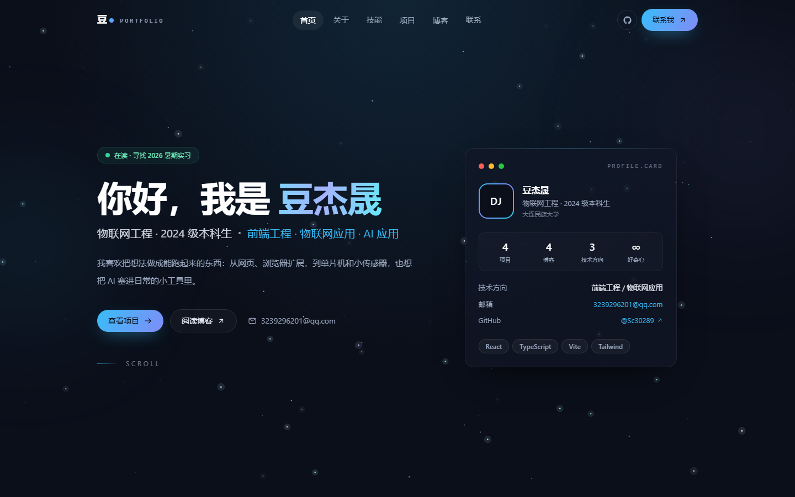

# 豆杰晟的个人网站

大连民族大学物联网工程 2024 级本科生。浅色极简主题的个人作品集 + 博客，从 0 到 1 独立完成并部署在 GitHub Pages。

- 在线访问：<https://sc30289.github.io/personal-site/>
- 产品需求：[PRD.md](./PRD.md)
- 技术设计：[TECH_DESIGN.md](./TECH_DESIGN.md)
- AI 协作约定：[AGENTS.md](./AGENTS.md)

## 功能

| 模块 | 说明 |
| --- | --- |
| 首页 | Hero、关于、技能、作品、博客、联系六个区块，网格背景 + 入场动画 |
| 项目 | 分类筛选、项目详情（Markdown 正文、亮点清单、上一个/下一个） |
| 博客 | 搜索 + 标签筛选、文章页目录（TOC）滚动高亮、阅读时长、上一篇/下一篇 |
| 联系 | 邮箱一键复制、表单校验、`mailto:` 唤起邮件客户端 |
| 管理后台 | `/admin` 登录后管理个人信息、技能、项目、博客与站点设置（localStorage 数据层） |
| 全局 | 吸顶毛玻璃导航、滚动进度条、返回顶部、404 页面、移动端菜单 |

## 管理后台

- 入口：<https://sc30289.github.io/personal-site/#/admin/login>
- 演示账号：`admin` ／ 密码：`admin123`
- 数据保存在浏览器 `localStorage`，公开页面读取同一份数据；可在「站点设置」导出 / 导入 JSON 或恢复默认

## 技术栈

- React 18 + TypeScript 5 + Vite 5
- Tailwind CSS 3（自定义设计 token）
- React Router 6（Hash 模式，适配 GitHub Pages 子路径）
- react-markdown + remark-gfm + rehype-highlight（博客 Markdown）
- 管理后台：React Router 路由守卫 + localStorage 数据层
- 无后端、无数据库、无第三方统计

## 本地开发

```bash
npm install
npm run dev        # http://localhost:5173
npm run build      # 类型检查 + 构建，产物在 dist/
npm run preview    # 预览构建产物
```

## 部署（GitHub Pages）

```bash
# 子路径部署：仓库名 personal-site
VITE_BASE=/personal-site/ npm run build -- --outDir docs
```

把 `docs/` 推到 `main` 分支，在仓库 Settings → Pages 中选择 `main` 分支的 `/docs` 目录即可。

## 目录结构

```text
src/
├── components/     # 可复用组件（导航、卡片、Markdown、TOC…）
├── pages/          # 路由页面
├── content/        # 个人资料、技能、项目、博客文章（唯一数据源）
├── lib/            # frontmatter / 阅读时长 / 目录生成
└── hooks/          # 自定义 hook
```

新增一篇文章只需要在 `src/content/posts/` 放一个带 frontmatter 的 `.md` 文件，列表、标签、阅读时长与目录会自动生成。

## 截图



## License

MIT
